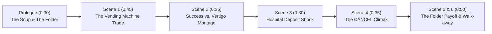

# 🎬 *The Life Vending Machine — The Price of Tomorrow*
**Format:** AI Short Film (Competition Entry)  
**Target Duration:** ~3 minutes 30 seconds (Strictly under 4:00)  
**Language:** English (with subtle, natural Malaysian warmth & cadence)  
**Setting:** Modern Kuala Lumpur, Malaysia  

---

## 💡 How We Elevate Your Original Concept (From "Ad" to "Award-Winning Short Film")

Your core metaphor—**the Vending Machine that trades Health/Time for Wealth**—is brilliant for AI video generation because it is visually iconic, moody, and high-concept. 

However, to win an AI film competition and avoid feeling like a traditional corporate commercial, here are **4 key improvements** applied to the script below:

> [!IMPORTANT]
> **1. Fixing Scene 5 (Removing the "Brochure Speak")**  
> In your original draft, Scene 5 has Ryan calling the insurance company to verify terms and eligible expenses. On screen, that immediately breaks the cinematic spell and feels like a hard sell.  
> **The Fix:** Never mention "claims procedures" or "coverage terms." Instead, use a **visual prop** planted in Scene 1—an old tin biscuit box or folder on the dining table that Ryan told his mom to stop wasting money on. At the hospital admissions desk, when Ryan is panicking over the RM 40,000 deposit, the nurse simply says, *"Actually, Mr. Tan, your mother's medical card already cleared pre-admission."* Subtle, realistic, and deeply relieving.

> [!TIP]
> **2. Adding a Real "Emotional Twist" (Using all 3 Buttons: WEALTH · HEALTH · TIME)**  
> Your genre lists *Emotional Twist (情感反转)*, so let's make the machine hit harder:  
> - In **Scene 4**, when Ryan rushes back to the machine to save his mom, he doesn't press `WEALTH`—he tries to buy **`HEALTH`** or **`TIME`** for his mother.  
> - **The Twist:** The machine flashes: `INSUFFICIENT BALANCE. YOU ALREADY SOLD YOUR TOMORROWS.` He realizes the machine only *takes*—it never truly protects. Real protection wasn't in a magic machine; it was quietly built by his mother years ago.

> [!NOTE]
> **3. Authentic Malaysian Vibe (Relatable, Not Stereotyped)**  
> - **Visuals:** Rainy KL nights, MRT/LRT pedestrian tunnel, the warm yellow glow of a 2-storey terrace house in PJ/Cheras, a thermal flask of herbal soup (*pak choi / red dates*) on Ryan's desk, and the terrifyingly real moment at a Malaysian private hospital counter: *"Cash or Medical Card?"*  
> - **Voice:** Natural Malaysian English—warm, slightly understated, with gentle *“lah”* or *“Ma”* only where a real Malaysian son and mother would say it.

---

## 📜 Full Upgraded Script (Runtime: ~3:30)

### **PROLOGUE — THE ORDINARY TABLE (0:00 – 0:30)**
**Visuals:**  
- **0:00** Close-up of a steaming stainless-steel thermal flask being placed on a cluttered dining table in a modest Malaysian terrace house. Rain taps against the louvre windows (*nako* windows).  
- **0:08** RYAN (26, Malaysian Chinese, wearing a slightly damp office shirt, dark eye circles) is staring at his laptop—a rejected pitch deck and a bank balance showing `RM 412.50`.  
- **0:15** Alongside the soup flask, MUM (late 50s, gentle eyes, reading glasses) slides a thin payment receipt into a worn plastic zip-folder labeled *"Family Documents."*

**Dialogue:**  
**RYAN** *(sighs, rubbing his temples)*:  
"Ma, everything’s going up lah. Why you still paying for that old policy every month? Keep the cash better."  

**MUM** *(soft smile, pouring warm soup into a bowl)*:  
"Just a little bit only. Drink first, before it gets cold."  

**RYAN** *(already grabbing his bag)*:  
"No time, Ma. Client wants revisions by midnight."  

---

### **SCENE 1 — THE FIRST TRADE (0:30 – 1:15)**
**Visuals:**  
- **0:30** 1:15 AM. A wet, neon-lit pedestrian underpass near an LRT station in KL. Fluorescent lights hum and flicker.  
- **0:40** Ryan walks alone. He stops. Recessed into the concrete wall is a vintage-futuristic vending machine glowing amber and cyan. No snacks inside—just three illuminated glass canisters:  
  - **`WEALTH`** *(Glowing Gold)*  
  - **`HEALTH`** *(Glowing Pulse Green)*  
  - **`TIME`** *(Glowing Hourglass Blue)*  
- **0:50** Digital text crawls across the CRT screen:  
  `WHAT WOULD YOU BUY?`  
  `RULE: EVERYTHING HAS A PRICE.`  
- **0:58** Ryan laughs bitterly and taps **`WEALTH — CAREER BREAKTHROUGH`**.  
- **1:03** The screen turns crimson:  
  `PRICE: 20% OF YOUR HEALTH.`  
  `[ CONFIRM ]   [ CANCEL ]`  
- **1:08** Ryan looks at his young hands. *I’m 26. I can tank it.* He presses **`CONFIRM`**.  
- **1:12** A metallic card clatters into the slot: **`YOUR OPPORTUNITY HAS ARRIVED.`** Simultaneously, his phone buzzes with an incoming message from a Senior Director.

---

### **SCENE 2 — THE COST OF WINNING (1:15 – 1:50)**
**Visuals (Fast, rhythmic montage):**  
- **1:15** KLCC skyline time-lapse. Ryan in a sharper suit, shaking hands in glass boardrooms, signing contracts.  
- **1:25** Quick cut: In the office washroom, Ryan braces against the sink. A sudden wave of vertigo blurs the mirror. A faint ringing sound (*tinnitus*) rises in the audio mix.  
- **1:35** Split visual / Match cut: Ryan’s desk piling up with awards and unopened thermal soup flasks from Mum.  
- **1:42** Voice mail playing over shots of Ryan working late in a dark office:

**Dialogue (Voiceover — Mum’s WhatsApp Voice Note):**  
**MUM (V.O.):**  
*"Ryan ah, Ma left lotus root soup in the fridge. Earning money is important, but don't forget to take care of your body, okay? Rest early."*  

**RYAN** *(mumbling at his screen, pale, coughing lightly)*:  
"Yeah, yeah... I know, Ma. Soon."

---

### **SCENE 3 — THE CRASH (1:50 – 2:20)**
**Visuals:**  
- **1:50** A high-end rooftop bar in KL. Champagne glasses clink. Colleagues applaud Ryan’s promotion.  
- **1:56** Ryan’s phone vibrates on the table: **`MUM (HOSPITAL)`**.  
- **2:02** Smash cut to harsh white fluorescent lights of a Malaysian hospital emergency corridor. Ryan sprints in, breathless, his own chest tightening from exhaustion.  
- **2:10** A doctor speaks calmly while showing an urgent scan. At the admissions counter, a staff member hands Ryan an estimated surgical deposit slip: **`RM 38,000.00`**.  
- **2:16** Ryan opens his banking app. He has a nice title, a new car loan, lifestyle inflation—and nowhere near enough liquid cash for an immediate crisis.

**Internal Monologue (Ryan V.O.):**  
*"I thought climbing faster meant I was ready. I wasn't ready for anything."*

---

### **SCENE 4 — THE SECOND TRADE & THE TWIST (2:20 – 2:55)**
**Visuals:**  
- **2:20** Pouring rain. Ryan runs back into the LRT underpass, soaked and desperate, slamming his hands against the vending machine.  
- **2:28** He reaches for **`WEALTH`**—and freezes. The screen reads:  
  `ADDITIONAL FUNDS — PRICE: YOUR REMAINING HEALTH.`  
- **2:34** Desperate, Ryan tries pressing **`HEALTH`** and **`TIME`** instead—wanting to buy them *for his mother*.  
- **2:40** The screen flashes coldly:  
  `ERROR: THIS MACHINE ONLY TAKES. IT CANNOT PROTECT.`  
- **2:45** His trembling finger hovers over `CONFIRM` to trade the rest of his life away for cash.  
- **2:48** In the glass reflection of the machine, he sees his own sunken eyes—and hears his mother’s voice: *"Don't forget to take care of your body."*  
- **2:52** Tears mixing with rain, Ryan slams **`CANCEL`**. He refuses to destroy himself.

---

### **SCENE 5 — QUIET PROTECTION (2:55 – 3:18)**
**Visuals:**  
- **2:55** Ryan walks back into his mother’s hospital ward, shoulders slumped, ready to confess he needs time to borrow the money.  
- **3:00** Mum is awake. Weakly, she points to her handbag on the bedside table. Inside is that same worn plastic zip-folder from the Prologue.  
- **3:05** A nurse walks in with a warm smile and a clipboard.

**Dialogue:**  
**NURSE:**  
"Mr. Tan, no need to worry about the deposit. Guarantee Letter just came through from your mum’s policy. We’re wheeling her in now."  

*(Ryan stares at the worn folder in his hands—the exact one he told her to cancel in the Prologue.)*  

**RYAN** *(voice cracking)*:  
"Ma... you kept it all these years?"  

**MUM** *(weak smile, patting his hand)*:  
"I hoped we’d never need to use it... But I never wanted my son to trade his health just to save mine."

---

### **SCENE 6 — THE LAST WALK (3:18 – 3:45)**
**Visuals:**  
- **3:18** Weeks later. Morning sunlight filters through the terrace house windows. Ryan—looking healthier—is the one pouring warm soup for his Mum before heading to work.  
- **3:25** Evening. Ryan walks through the pedestrian underpass one last time.  
- **3:28** The Vending Machine flickers on: `WHAT WOULD YOU BUY?`  
- **3:32** Ryan looks at **`WEALTH · HEALTH · TIME`**. He realizes he already has all three—as long as he protects them.  
- **3:35** He gives a quiet, knowing smile and walks past without stopping. Behind him, the vending machine's neon lights power down one by one into darkness.  
- **3:40** ** Fade to Black. Title Cards:**

> **“NOT EVERY PRICE HAS TO BE PAID WITH YOUR LIFE.”**  
> *(并不是人生中的每一份代价，都需要用生命去交换。)*  
>  
> **“Tomorrow is unpredictable. Prepare for it today.”**  
> **[Brand / Competition Logo]**

---

## 🤖 Why This Version Excels for AI Video Generation

1. **Visual Continuity Props (AI-Friendly):** Instead of long lip-synced conversations about insurance terms (which AI video often struggles to make natural), the story relies on **two visual anchors**: the **Stainless Steel Soup Flask** (Mother's love for his health) and the **Worn Plastic Folder** (Mother's quiet preparation).
2. **High-Contrast Lighting:** The neon-drenched LRT underpass vs. warm Malaysian home lighting vs. sterile hospital white gives AI video generators (like Veo, Kling, Runway, or Sora) distinct color palettes for every act.
3. **Zero Hard-Sell:** Insurance is never "pitched." Instead, the **Vending Machine represents reactive sacrifice** (paying with your life when crisis hits), while **Insurance represents proactive love** (a mother refusing to let her child bear the burden alone).
