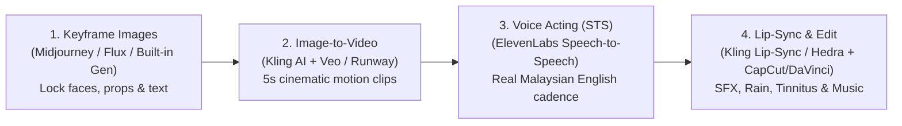

# 🎨 Visual Bible & AI Video Competition Workflow
## *The Life Vending Machine — The Price of Tomorrow*

All reference images below have also been saved into your project workspace at [assets/references](file:///c:/Users/User/Desktop/AI%20Video/assets/references).

---

## 1. Character & Scene Reference Sheets

Use these 4 master reference frames as **Character / Subject Reference inputs** in your AI video generator so Ryan, Mum, the Vending Machine, and the Malaysian home look 100% consistent across every shot.

````carousel

<!-- slide -->

<!-- slide -->

<!-- slide -->

````

---

## 2. Recommended AI Video Competition Workflow

Because your film blends **grounded Malaysian family drama** with **high-concept sci-fi/fantasy**, a **Keyframe-First (Image-to-Video)** pipeline will give you 10× better consistency and cinematic control than pure Text-to-Video.



### Step 1: Always Generate Static Keyframes First (Image-to-Video > Text-to-Video)
> [!IMPORTANT]
> **Why?** Pure text-to-video often garbles text on screens (like `"WHAT WOULD YOU BUY?"` or `"PRICE: YOUR HEALTH"`) and changes the actor's face between shots. By generating the still image first (or letting me generate all 35 shot keyframes for you right here), we lock in:
> - Exact English text on the Vending Machine CRT screen and hospital deposit slip (`RM 38,000.00`).
> - Ryan’s and Mum’s exact faces and clothing.
> - Malaysian details (*nako* louvre windows, stainless steel soup flask, plastic zip-folder).

### Step 2: Best AI Video Models for This Script (The Hybrid Stack)

| Scene Type | Best Tool | Why It Wins for This Shot |
| :--- | :--- | :--- |
| **Emotional Acting & Two-Person Shots** *(Prologue dining table, Scene 5 hospital ward)* | **Kling AI (2.0 / 1.6 Pro)** with *Elements (Subject Reference)* | Best-in-class facial micro-expressions (Ryan holding back tears, Mum's gentle smile) and allows uploading [ryan_reference.jpg](file:///c:/Users/User/Desktop/AI%20Video/assets/references/ryan_reference.jpg) + [mum_reference.jpg](file:///c:/Users/User/Desktop/AI%20Video/assets/references/mum_reference.jpg) together. |
| **Vending Machine & KL Rain Atmosphere** *(Scene 1, Scene 4, Scene 6)* | **Google Veo** or **Runway Gen-3 Alpha Turbo** | Incredible lighting physics—neon reflections on wet KL tunnel tiles, flickering CRT screens, and dramatic push-in camera moves. |
| **Fast Success / Vertigo Montage** *(Scene 2)* | **Luma Ray2** or **Kling Start-to-End Frame** | Using **Start Frame + End Frame** transitions lets you smoothly morph Ryan from a bright boardroom directly into his dark office or bathroom sink. |

### Step 3: How to Nail Authentic Malaysian English Voices (Crucial for Judges!)
Standard AI text-to-speech sounds either too American or too British, which breaks the Malaysian immersion immediately.
> [!TIP]
> **Use ElevenLabs "Speech-to-Speech" (Voice Changer) instead of Text-to-Speech:**
> 1. Record yourself (or a friend/mum) reading the 12 lines of dialogue on your phone in natural Malaysian English—with the exact pause before *"lah"*, *"Ma"*, and *"Drink first, before it gets cold."*
> 2. Upload your phone recording into **ElevenLabs Speech-to-Speech** and pick a warm Asian/Neutral voice model.
> 3. ElevenLabs will keep **100% of your Malaysian accent, rhythm, and emotional sigh**, while turning the audio into studio-grade cinema sound!
> 4. **Minimize on-camera lip-sync:** Out of the 3:30 runtime, 70% of dialogue can play over reaction shots, close-ups of hands/props, or voiceover. Only lip-sync 4–5 key emotional sentences using **Kling Lip-Sync** or **Sync Labs**.

### Step 4: Sound Design Secret Weapon (How to Hook Judges in the First 30 Seconds)
- **The Audio Contrast:**
  - **Home / Mum scenes:** Warm tropical rain on glass windows, ceramic spoon clinking against a porcelain soup bowl.
  - **Vending Machine scenes:** Deep electrical hum, heavy mechanical button *clunk*, eerie CRT buzz.
  - **Scene 2 & 3 (Health cost):** Layer a faint, rising **high-pitched tinnitus ring + muffled heartbeat** every time Ryan overworks, peaking right when he gets the hospital phone call, and finally disappearing in Scene 6 when he walks away from the machine.
